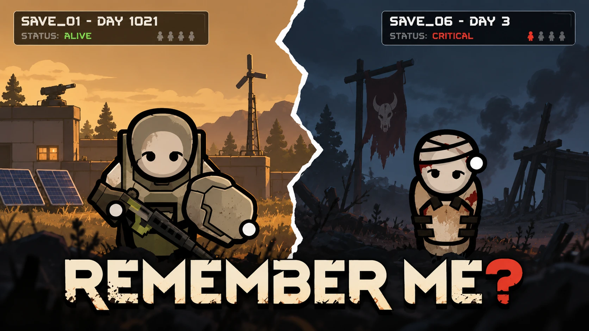

# Remember Me?



A RimWorld 1.7 (Waylith) mod: colonists from your old games turn up in your new world.

The mod reads your old saves in the background and keeps an archive of every colonist who ever lived in them, alive or dead. With a small chance, a pawn the game is about to create becomes one of those people instead, with the same name, look, traits, skills, backstory, genes and prosthetics.

Where they end up depends on who they were:

- former ideology leaders and nobles tend to become faction leaders;
- veterans with many kills and bloodthirsty traits turn up in raids;
- merchants run trade caravans;
- tribal colonists join tribes, xenohumans join factions of their own kind;
- others come as visitors, refugees, wanderers who join, or slaves for sale;
- children from old colonies come back grown up;
- two people from the same old colony get an "old comrade" relation.

Colonists who died come back through their own rare event: as a wanderer, and with Anomaly as a creepjoiner or a shambler.

Settings: chance per event, chance per new faction leader, cooldown, letters, which roles are used, which old colonies count.

## Русский

Колонисты из ваших старых игр никуда не делись. Мод читает старые сохранения, собирает архив всех колонистов и иногда возвращает кого-то из них в новый мир: гостем, торговцем, рейдером, беженцем, рабом на продажу, лидером фракции или новым членом колонии. Кем станет человек, зависит от его прошлой жизни. Погибшие возвращаются отдельным событием, а с Anomaly приходят жутким странником или бродячим мертвецом.

## Requirements

- RimWorld 1.7
- [Harmony](https://steamcommunity.com/sharedfiles/filedetails/?id=2009463077)
- DLCs are optional; Royalty, Ideology, Biotech and Anomaly content is used when present.

## Installing

Copy `About`, `Defs`, `Languages` and `1.7` into `RimWorld/Mods/RememberMe` and enable the mod after Harmony.

## Building

Needs the .NET 10 SDK.

```bash
dotnet build Source/PastLives/PastLives.csproj -c Release
```

The project expects RimWorld at the default Steam path and Harmony from the Workshop. Override with `-p:RimWorldDir=...` and `-p:HarmonyDir=...` if yours are elsewhere. The output goes to `1.7/Assemblies`.

## Self-test

Launch the game with `-quicktest -pastlives-selftest` (plus `-mod=2009463077;frbyyy.rememberme` to load only Harmony and this mod). It forces every kind of appearance once, writes the results to `Player.log` and quits.

The archive is stored in `SaveData/PastLives/archive.xml`.
